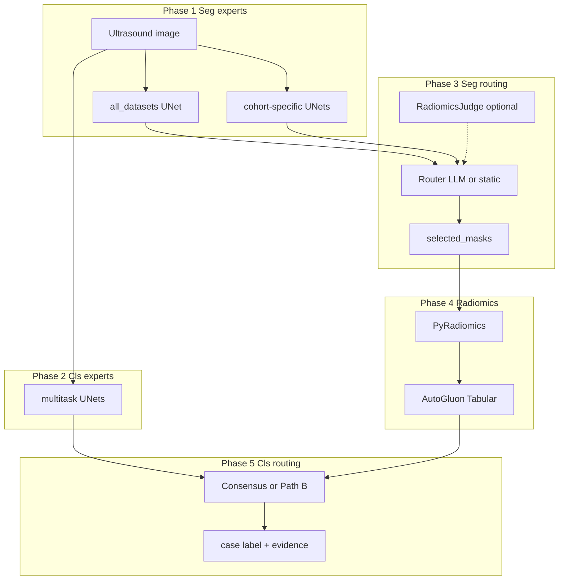

# B12 图像侧数据流（草稿，待与 S9 / B1 合并制图）

## 开发资源（Methods 4.1 / Table S1）

- **堆叠训练**：多队列 train 合并（最大约 18,277 张）→ 训练 **all_datasets** 等 DINO-UNet 专家；各队列另训 **TN3K / TN5K / ThyroidXL / PKTN** 等 checkpoint。
- **验证（850 张）**：OpenThyroidDB 统一 validation split（与 Table S1 一致）→ **best_single 专家选择**、**学习型路由拟合**、**B8 拒答/校准阈值**（仅验证集，测试集不调参）。
- **AutoGluon radiomics**：在 **dataset_3** 上用 **GT mask** 提取特征训练（17,774 行）；权重见 `radiomics_judge.model_dir`。

## 测试（仅评估）

| 任务 | 测试队列（示例） |
|------|------------------|
| 分割 + 分类 | TN3K, TN5K, ThyroidXL, DDTI, ZJH-8K, RJH-7K（分割）, NHC-MISD-TUS |
| LNM / FTC-PTC | 见 B9（ZJH-8K 恶性子集、LymphUs、外测） |

ZJH-8K 在主任务与外部分割/分类测试与 LNM 开发上的角色在图中需 **分边标注**（B9 文案）。

## 推理五阶段（`pipeline/cascade.py`）

## 操作阈值（config 默认，开发集固定）

| 参数 | 典型值 | 选定位置 |
|------|--------|----------|
| Seg binarization | 0.5 | 固定超参 |
| Pre-filter cosine | 0.8 | 固定超参 |
| Prob outlier | 0.4 | 固定超参 |
| Ensemble binarization | 0.5 | 固定超参 |
| Cls consensus shortcut | conf ≥ 0.6 | 固定超参 |
| Best-single expert | — | **Validation**（Dice / AUROC） |
| Learned router | — | **Validation** fit |
| Abstention / review flags | — | **Validation** only (B8) |

主文 ThyroidXAgent（S4）为 **LLM 路由 + 全信号**；`config/revision/nhc_no_llm_primary.yaml` 为 **无 LLM** 的 NHC/B7/B8 冻结配置，图中应分开展示。

## 指标聚合（B12 / R2.7）

- **单队列**：图像级 AUROC/AUPRC（`pipeline/evaluate.py`）；CI 定稿与 B2 cluster bootstrap 对齐。
- **跨五队列分类测试**：**等权宏平均** AUROC 0.9001、AUPRC 0.8705；可选报告样本量加权 0.9228 / 0.9533。
