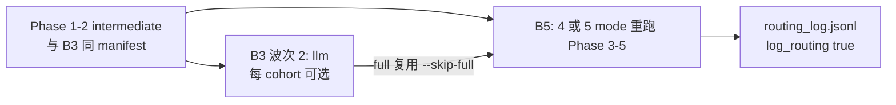

# B5 构建与跑数计划

**最后更新**：2026-10-26  
**字段级规范**：[`REVISION_B5_PLAN.md`](../../REVISION_B5_PLAN.md)  
**任务理解**：[`B5_UNDERSTANDING_ZH.md`](./B5_UNDERSTANDING_ZH.md)

---

## 1. 前置依赖（必须先满足什么）



| 依赖 | 是否阻塞 B5 | 说明 |
|------|-------------|------|
| B3 **八种策略全部完成** | **否** | B5 不需要 soft_voting 等波次 1 结果 |
| B3 **`llm`（= `full`）** | **强烈建议** | `--skip-full` 时指标从 `output/ablation/b3/<cohort>/llm` 并入；无则缺 `full` 行且无法填主 Δ |
| 共享 **intermediate** | **是** | 各 cohort `pipeline.ablation.shared_intermediate` 必须存在且与 B3 一致 |
| **B6 日志** | **跑数时开启** | 配置 `pipeline.log_routing: true`；分析阶段必需 |
| **B2 cluster bootstrap** | 定稿前 | 开发期可用图像级 bootstrap；投稿前与 B2 对齐重算 |
| **DASHSCOPE_API_KEY** | LLM mode 是 | 与 B3 波次 2 相同成本模型 |

**建议顺序**：B6 规范已就绪 → 确认 `metadata_prompt` 与 agent 接入 → `sample` 五 mode 试跑 + prompt 抽查 → 各 cohort B3 `llm`（或与 B5 `full` 合并一次）→ `run_b5_batch --skip-full` → `build_b5_tables` + `analyze_routing_bias`。

---

## 2. 代码架构（目标数据流）

```
config/revision/b5/<cohort>.yaml
        │
        ▼
scripts/revision/b5/run_b5_batch.py
        │  subprocess
        ▼
scripts/run_routing_ablation.py
  --routing-mode llm
  --metadata-mode <mode>
  --shared-intermediate <path>
  --output-dir output/ablation/b5/<cohort>/<mode>
        │
        ├── shared/metadata_prompt.py  （五种 mode 过滤）
        ├── segmentation/agent.py
        └── classification/agent.py
        │
        ▼
scripts/revision/b5/build_b5_tables.py  →  artifacts/b5_*.csv / .json
pipeline/revision/b5/analyze_routing_bias.py  →  figures/ + mi.json
```

### 2.1 实现状态（仓库，2026-10-26）

| 组件 | 路径 | 状态 |
|------|------|------|
| 字段过滤 | `shared/metadata_prompt.py` | ✅ |
| Agent 接入 | `segmentation/agent.py`, `classification/agent.py` | ✅ |
| CLI | `scripts/run_routing_ablation.py --metadata-mode` | ✅ |
| 批量 | `scripts/revision/b5/run_b5_batch.py` | ✅ |
| 配置 | `config/revision/b5/*.yaml` | ✅ |
| 汇总 | `scripts/revision/b5/build_b5_tables.py` | ✅ |
| 偏倚分析 | `pipeline/revision/b5/analyze_routing_bias.py` | ✅（需 matplotlib） |
| 单测 | `tests/test_metadata_prompt.py` | ✅ |
| Path B LLM prompt 消融 | — | ❌ 未做（见理解文档 §7） |
| **`output/ablation/b5/` 实验产物** | — | ⬜ 尚未跑数 |

跑数前 **P0 验证**（不必等全队列 B3）：

1. `pytest tests/test_metadata_prompt.py`  
2. `sample` 单 mode：`run_routing_ablation.py` + `routing_log_include_prompts: true` 抽查 2–3 例  
3. 确认 `input_data_info` / `device_info` 在目标 cohort 配置中非空（使 `drop_source` 有意义）

---

## 3. 跑数操作（复制即用）

### 3.1 单 cohort、单 mode（调试）

```bash
python scripts/run_routing_ablation.py \
  --config config/revision/b5/sample.yaml \
  --routing-mode llm \
  --metadata-mode drop_device \
  --task both \
  --shared-intermediate output/sample/pipeline_run/intermediate \
  --output-dir output/ablation/b5/sample/drop_device \
  --force-phase3
```

### 3.2 单 cohort 五 mode（`full` 复用 B3）

```bash
# 前提: output/ablation/b3/<cohort>/llm 已存在且 manifest 一致
python scripts/revision/b5/run_b5_batch.py \
  --config config/revision/b5/tn3k.yaml \
  --skip-full \
  --force-phase3
```

### 3.3 全队列（生产草案）

本机批跑（**不含 NHC**）：

```bash
for c in sample tn3k tn5k thyroidxl zjh8k rjh7k ddti_cls ddti_seg pktn; do
  python scripts/revision/b5/run_b5_batch.py --config config/revision/b5/$c.yaml --skip-full --force-phase3
done
```

**成本**：仅 Path B 且 **LLM 被调用** 的病例耗 token；`full` 复用可省约 1/5 API。建议 `--jobs 1` 串行、按 `results.json` 完整性断点续跑。

### 3.4 汇总与分析

```bash
python scripts/revision/b5/build_b5_tables.py --root output/ablation/b5

python pipeline/revision/b5/analyze_routing_bias.py \
  --log output/ablation/b5/nhc_misd_tus/full/routing_log.jsonl \
  --labels /path/to/NHC/labels.json \
  --centre-key <配置中的 centre 字段> \
  --out figures/b5_nhc_centre_expert.png
```

`centre_key` 写入 `config/revision/b5/nhc_misd_tus.yaml` 的 `pipeline.ablation.centre_key`（实现时读一条 label 定键名）。

---

## 4. 队列与任务开关（config/revision/b5）

| 类型 | cohort | 备注 |
|------|--------|------|
| for_llm 子集 (~250) | tn3k, tn5k, thyroidxl, zjh8k, rjh7k, ddti_* 等 | 与 `build_all_test_for_llm.sh` 对齐 |
| 全量 / 特殊 | pktn（150 全量） | 见 `config/revision/b5/README.md` |
| 开发 | sample | 可先 smoke |
| NHC | nhc_misd_tus | 全量测试路径；**热图主战场**；依赖 `labels.json` 与中心字段 |

任务：`ddti_seg` / `pktn` / `rjh7k` **仅分割**；`ddti_cls` **仅分类**；其余 `both`。

---

## 5. 验收 checklist（B5 完成标准）

- [ ] 与 B3 一致的各 `dataset_id` 均有 **5 种 mode** 的完整 `results.json` + metrics（`full` 可与 B3 `llm` 同目录或指标一致）。  
- [ ] `full` 与 B3 `llm` 使用 **同一 `intermediate_manifest.json`**。  
- [ ] NHC **`full`** 的 `routing_log.jsonl` 可生成 **中心 × 专家** 热图。  
- [ ] `build_b5_tables.py` 产出 **`full → quality_only`** 的 ΔDice、ΔAUROC，可填回复 R3.2。  
- [ ] 补充材料注明热图/互信息 **分母**（`llm_invoked`；seg/cls 分列或分 task）。  
- [ ] B2 定稿后 CI 口径与主表一致（必要时重跑 evaluate 汇总）。

---

## 6. 风险与缓解

| 风险 | 缓解 |
|------|------|
| B3 `llm` 未跑完 | 优先波次 2；B5 批跑使用 `--skip-full` |
| `input_data_info` 为空 | 按 `REVISION_B5_PLAN.md` §7.2 注入；NHC 按图 merge 标签 |
| NHC `labels.json` 缺失 | 修正 `label_file` 或数据同步后再跑 L1/B3/B5 |
| API 成本 | `full` 复用；开发用 `max_images` + `sample` |
| Path B 未消融 metadata | 稿面 Methods 如实写范围；不夸大 Path B LLM 输入 |

---

## 7. 建议人日（与详规 §11 一致）

| 阶段 | 内容 | 估时 |
|------|------|------|
| A | 确认 prompt 过滤 + 单测 + sample 抽查 | 0.5–1 d |
| B | 各 cohort B3 `llm`（若尚无） | 2–5 d（API） |
| C | B5 四 mode 批跑 + 断点 | 2–5 d |
| D | 表 + 热图 + 回复数字草稿 | 1 d |

实验数字与勾选状态维护在 [`B5_STATUS_ZH.md`](./B5_STATUS_ZH.md)。
