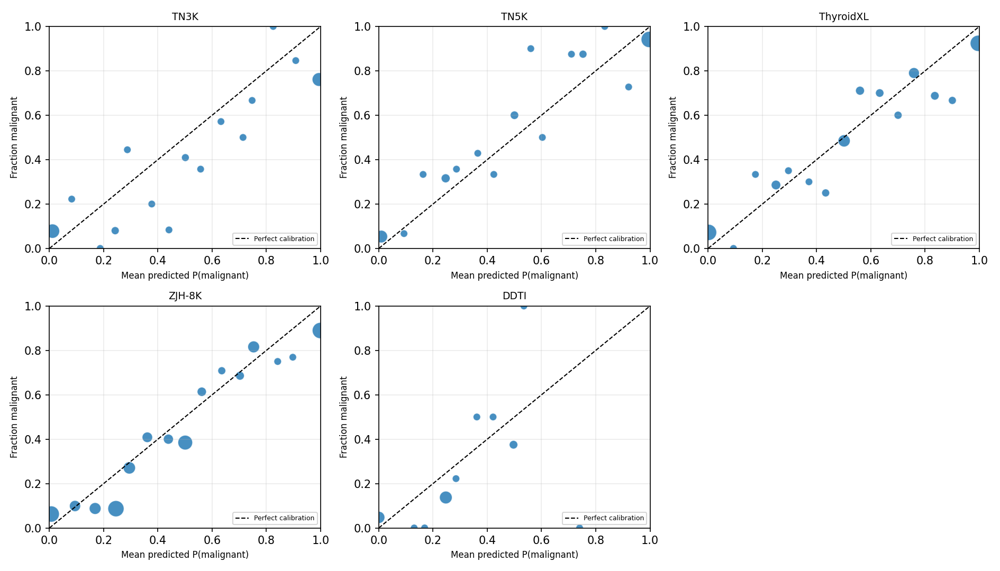
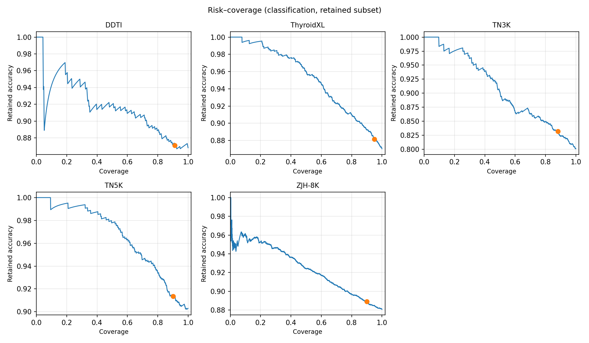
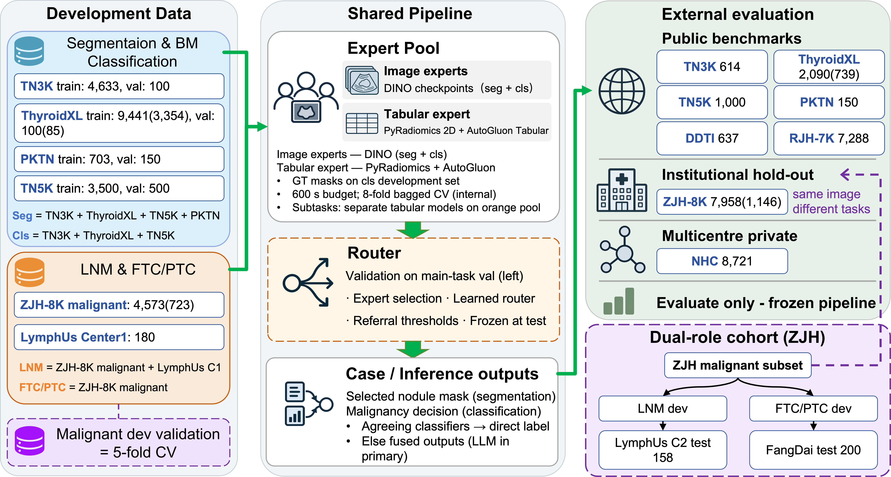

# 审稿意见回复

手稿：ThyroidXAgent（*Nature Communications* 大修）。

---

## 审稿人 1 — 意见 1（R1.1）

**审稿意见：**
分割与分类结果大多以图像层面报告。作者应澄清患者层面与检查层面的划分、跨数据集的去重，以及同一患者的多个帧或视图是否会跨划分出现。患者层面的再分析和聚类感知的置信区间会增强对报告性能的信心。

**回复：**

- 感谢审稿人。我们已按下列方式修订统计报告。
- 独立性与近重复：在 **TN3K、TN5K、ThyroidXL、DDTI、PKTN、ZJH-8K** 等**各来源队列之间**做感知哈希（dHash，Hamming ≤ 5）筛查（见文末 **表 R1**）。其中与 **审稿人 2 — 意见 4**（ZJH 与 TN3K 关系）最相关的是：TN3K（官方 train+val+test）与 ZJH-8K 共 **1156** 对 H=0 图像对；若仅看 TN3K **官方 test** 与 ZJH-8K，则为 **2** 对 H=0。
- 聚类定义：ZJH-8K、ThyroidXL 使用可复现 patient ID；无 ID 队列 **一图一簇**。Bootstrap **1000** 次、**seed=42**，CI 为 cluster-aware。
- 患者级分类：ZJH-8K、ThyroidXL 对图像概率 **簇内/患者内算术平均** 后报告 AUROC/AUPRC。
- 聚类 bootstrap 置信区间：均用 **1000** 次聚类 bootstrap（**seed=42**）重算 **95% CI**。完整结果见文末 **表 R2–R3**（**Table S4**）（良恶性分类，**7** 方法 × **5** 外测队列）与文末 **表 R4**（**Table S3**）（结节分割，**5** 方法 × **7** 外测队列；Dice 与 HD95）。**DDTI** 分类外测 **n=349**；分割 **DDTI** 为 **637** 图。

**支撑材料：** 见文末 **表 R1**（dHash 近重复筛查）、**表 R2–R3**（Supplementary Table S4，AUROC/AUPRC）、**表 R4**（Supplementary Table S3，分割 Dice/HD95）。

---

## 审稿人 1 — 意见 3（R1.3）

**审稿意见：**
尽管在私有多中心队列上的总体性能令人鼓舞，但中心层面差异很大。例如，某些中心的结节分割性能低得多。作者应研究其与扫描仪类型、图像质量、病例构成与标注协议的关联，并为低置信病例定义校准、拒答或强制人工复核策略。

**回复：**

- 我们同意中心异质性重要。NHC-MISD-TUS 中心级分析（审稿人 2 意见 6）待中心元数据齐备后单独报告（见对审稿人 2 意见 6 的回复）。此处就五个有良恶性病理标签的外测队列报告校准与送复核策略。
- 在五个有病理标签的外测队列上，以投票熵、top-2 margin、分割专家最小 pairwise IoU 定义不确定度（与主文测试协议一致）；**在每个外测队列自身**上按分位数定阈（熵与 margin/IoU 分别取分位），**任一**超阈即送复核（OR 组合），并调节分位使各队列送复核比例落在约 **5%–15%**（**表 R4**，一位小数）。
- **表 R4** 中 ECE/Brier 为各外测全集上的校准指标（图像级预测，与 Table S4 同口径）。文末 **图 R1–R2** 均基于 **表 R4** **同一套各队列自身分位定阈**结果；风险–覆盖率曲线上**工作点**与 **表 R4** 送复核%一致。各队列保留子集上的分类表现见补充材料。
- 我们将其表述为回顾性工作流：低不确定度病例可自动采纳模型输出，高不确定度病例送人工复核。Methods 中已说明阈值拟合与评估划分；送复核病例的临床处置边界在 Limitations 与讨论中说明。

**支撑材料：** 见文末 **表 R4**（外测校准与送复核）、**图 R1**（可靠性图）、**图 R2**（风险–覆盖率曲线）。

---

## 审稿人 1 — 意见 4（R1.4）

**审稿意见：**
ZJH-8K 被描述为分割与良恶性分类的外部测试集，而它的恶性图像又被用于 LNM 与 FTC/PTC 任务的开发。由于任务不同，这也许可以接受，但稿件应提供一张完整的数据流图，说明每个组件分别用了哪些数据做训练、验证、阈值选择与测试。

**回复：**

- 分割与通用良恶性专家 **未在 ZJH-8K 训练**；ZJH 恶性子集仅用于 LNM/FTC 任务开发，外测分别为 LymphUs Center 2 与 FangDai。图像侧各组件的训练、验证与外测数据划分见文末 **图 R3**。

**支撑材料：** **图 R3**（图像侧数据流图）。

---

## 审稿人 1 — 总评（可部署性）

**审稿意见：**
该工作有明显优点……然而，当前证据支持的是一条有前景的回顾性工作流，而非已确立的临床获益或广泛可部署性。因此，我建议至少给「大修」。

**回复：**

- 我们已在全稿弱化可部署性表述，强调回顾性评估、修订后的统计报告（数据审计与 cluster-bootstrap 置信区间）及明确局限性；代码可用性见数据与代码可用性声明。

---

## 审稿人 2 — 意见 1（R2.1）

**审稿意见：**
若干关键数值在摘要、正文、图与补充材料之间不一致。

**回复：**

- 我们致歉并已按源结果逐项核对。
- 良恶性分类「均值」（摘要、§2.2）：更正为 Table S4 **五队列等权宏平均** AUROC **0.9001**、AUPRC **0.8707**（见文末 **表 R6**）；按测试图像数加权 AUROC **0.9286**、AUPRC **0.9533**（与 **表 R2–R3** 中 ThyroidXAgent 五队列点估计一致）。
- Fig.3b：AUROC/AUPRC 轴标签标反，已与 **Table S4** 及 **表 R6** 宏平均对齐。
- LNM 训练池更正为 **4936** 图（4756 ZJH 恶性 + 180 LymphUs C1）；五折 CV 合并 manifest **4753** 图。**Table S5** 分 **独立外测（S5a）** 与 **开发集五折 OOF（S5b）**；通用基线行仅在 S5b 中与投稿 Supplementary Table S5 一致（见文末 **表 R7**）。

**支撑材料：** 见文末 **表 R6**（五队列汇总均值）、**表 R7**（Supplementary Table S5a/S5b）。

---

## 审稿人 2 — 意见 2（R2.2）

**审稿意见：**
许多分析以图像层面报告，尽管同一患者、检查或结节可能有多个图像。例如 ZJH-8K 包含来自 1,149 例的 7,958 张图像。把相关图像当作独立观测可能产生过窄的置信区间。作者应使用患者层面或检查层面的 bootstrap 重采样重算置信区间，并对具有临床意义的分类任务报告患者层面性能。

**回复：**

- 我们同意：将同一患者/检查的多张图像当作独立观测会使 bootstrap 置信区间偏窄，且与临床决策单位不一致。
- **统计协议（Methods）**：凡队列提供可复现 **patient ID**（ZJH-8K、ThyroidXL），bootstrap 在 **患者簇** 上有放回重采样（**1000** 次，**seed=42**），再展开到图像计算指标；无 ID 外测队列（如 TN3K、TN5K、DDTI）按 **一图一簇** 处理。**Tables S3–S5** 中 AUROC/AUPRC/Dice 的 **95% CI** 均按此 cluster-bootstrap 协议报告。
- **哪些队列 CI 会变**：**TN3K、TN5K、DDTI** 等无患者 ID 外测队列因一图一簇，cluster-bootstrap **95% CI 与逐图 bootstrap 一致**（点估计不变）。**仅 ZJH-8K 与 ThyroidXL** 图像级 CI 因簇内相关性而略宽，并 **另报患者级**分类与分割（**表 R8**、**表 R9**）；其余良恶性外测队列见文末 **表 R2–R3**。
- **ZJH 患者簇（全稿一致）**：对 ZJH 图像采用同一 **患者级 cluster** 规则（基于可复现患者 ID / 姓名映射，与恶性子任务开发集同一规则）。**1146** 簇（全外测）与 Table S5 恶性开发池簇数不同，仅因 **纳入图像子集**不同，而非两套划分键。
- **良恶性分类（患者级，主分析补充）**：对 ZJH-8K、ThyroidXL，在图像级恶性概率基础上，于患者内 **算术平均** 得到患者分数；患者标签为组内图像标签的 **max**（任一张恶性→恶性），再报告患者级 AUROC/AUPRC 及 cluster-bootstrap CI（**表 R8**、**表 R9**）。正文/补充材料在图像级 Table S4 之外增加患者级一行或附表。
- **分割**：图像级 Dice 仍为逐图计算；完整 **Table S3** 见文末 **表 R4**；ZJH-8K、ThyroidXL **患者内 Dice 均值**见文末 **表 R9**。
- **恶性子任务（LNM、FTC/PTC）**：**Table S5a** 为 LymphUs Center 2 / FangDai **外测**（三专家），**Table S5b** 为开发集**五折 OOF**，与图像级 bootstrap 分开表述。
- **ZJH-8K 患者数**：可复现 ID 聚合为 **1146** 例（**7958** 图）；审稿人所述 **1149** 例为队列原始登记口径，差异在 Methods 中说明（无 ID 或重复登记图像的处理规则）。

**支撑材料：** 完整 **Table S3/S4** 见 **表 R2–R4**；ZJH-8K / ThyroidXL 患者级结果见文末 **表 R8**、**表 R9**。

---

## 审稿人 2 — 意见 3（R2.3）

**审稿意见：**
请澄清为什么把 28,458 个观测描述为「non-overlapping test cases」，因为这个数字似乎把 19,737 张测试图像与 8,721 个 NHC-MISD-TUS 病例合并在一起。

**回复：**

- 审稿人正确：28,458 = 七个分割/分类队列 **19,737** 张测试图 + NHC **8,721** 例之和；称「cases」不准确且未含报告生成与恶性子任务测试。已改为分层计数，见 **图 R3**。

**支撑材料：** **图 R3**（分层测试计数与图像侧数据流）。

---

## 审稿人 2 — 意见 4（R2.4）

**审稿意见：**
ZJH-8K 与 TN3K 都采集自南方医科大学珠江医院。除非能证明它们在患者人群、采集时段、队列构成与临床流程上确实独立，否则 ZJH-8K 不应被描述为外部中心队列。

**回复：**

- ZJH-8K 与 TN3K 虽同属珠江医院来源，但队列用途与采集框架不同；我们已弱化「外部中心」表述，并报告**各基础队列之间**的 dHash 近重复（与上文 **审稿人 1 — 意见 1** 相同口径，见文末 **表 R1**）。TN3K（train+val+test）与 ZJH-8K：**1156** 对 H=0；TN3K **官方 test** 与 ZJH-8K 仅 **2** 对 H=0，提示公开 test 子集与 ZJH 几乎无逐像素重复。具备患者 ID 时，患者层面重叠在 Methods / Limitations 中说明。

**支撑材料：** dHash 筛查见文末 **表 R1**（与 R1.1 同口径）。

---

## 审稿人 2 — 意见 7（R2.7）

**审稿意见：**
作者应澄清所报告的「均值」是跨队列的无权重宏平均、按样本量加权的平均，还是其他计算方式。

**回复：**

- 跨五个 Table S4 外测队列的「均值」均为 **等权宏平均**；更正数字与分队列点估计见文末 **表 R6** 及 **表 R2–R3**。

**支撑材料：** 见文末 **表 R6**（等权宏平均与加权平均）。

---

## 审稿人 2 — 意见 9（R2.9）

**审稿意见：**
稿件称 LLM 路由器通过「推理」选择最佳专家输出，但未报告 prompt 设计、LLM 版本、解码参数、可复现性，以及当候选输出质量相近时的决策稳定性。……作者应提供至少 10 个代表性病例的结构化路由记录……

**回复：**

- LLM 路由器的 **模型与解码参数、完整 prompt 模板、输出 JSON 模式** 及 **结构化 routing_log 字段**见文末 **附录 A1**（修订稿将同步写入补充材料）。主评估队列 TN3K `test_for_llm_malignancy`（250 例）每次路由均记录于 `routing_log.jsonl`；在 **固定 Phase 1–2 专家输出** 前提下，对稳定性子集 **10** 例每例重复 **5** 次 **分割** LLM 路由（Path A 分类共识不重复 5× 分类；Path B 另报告分类侧一致率）。平均选择一致率 **98%**（**9/10** 五次完全相同；**1/10** 为 **80%**，`TN3K_test_0009.jpg`，重复间在 `all_datasets` 与 `TN3K` 间混选一次，Dice range ≈ 0.017）。本批 **10/10** 为 **close** 分层（见 **表 R10**），未出现 **easy** 例，故仅报告 close 层。
- **分层（`disagreement_tier`）**：按分割候选 inter-expert `average_agreement` 排序，top1 与 top2 差值 **≤ 0.10** 为 **close**（候选质量相近），**> 0.10** 为 **easy**（胜者分明）。稳定性表中的「分层」为每例一次路由时的标签，非按数据集分层。

**支撑材料：** 见文末 **表 R10**（路由稳定性）、**附录 A1**（LLM 路由器规格与 routing_log 字段）。

---

## 审稿人 2 — 意见 10（R2.10）

**审稿意见：**
对 FTC/PTC 分类，训练队列由经典型 PTC 与滤泡变异型 PTC 组成，而外部测试集由 FTC 与 PTC 组成。由于滤泡变异型 PTC 并不等同于 FTC，训练与测试的目标定义不同。……

**回复：**

- 我们承认 FVPTC≠组织学 FTC，将 FangDai 外测表述为 **探索性域迁移**，与主结论区分。
- **FangDai 外测**（**Table S5a**）与 **开发集五折 OOF**（**Table S5b**）见文末 **表 R7**。我们将 FangDai 外测表述为探索性域迁移；组织学 FTC 与训练标签（含 FVPTC）不一致之处在 Limitations 中与临床合作者说明。

**支撑材料：** 完整 **Table S5** 见文末 **表 R7**。

---

## 审稿人 2 — 意见 11（R2.11）

**审稿意见：**
LNM 任务只使用了 4,753 张恶性图像，而 Table S5 显示验证只有 20 例……请澄清：(a) 是否使用了迁移学习或多任务学习；(b) 是否做了数据增强；(c) 如何避免过拟合……

**回复：**

- 训练规模更正为 **4936** 图；将 20 例 val 改为 **882** 簇上 **患者级分层五折 OOF**（seed 42），见 **Table S5b**（ThyroidXAgent LNM OOF AUROC **0.8710 ± 0.0550**，AUPRC **0.8929 ± 0.0537**）。**LymphUs Center 2** 外测见 **Table S5a**，与正文一致：ThyroidXAgent LNM AUROC **0.8642 ± 0.0550**，AUPRC **0.8808 ± 0.0537**。

**支撑材料：** 完整 **Table S5** 见文末 **表 R7**。

---

## 审稿人 2 — 意见 12（R2.12）

**审稿意见：**
对淋巴结转移预测，稿件不一致地使用总体 LNM、侧颈 LNM 与 CN0/CN1 标签。……

**回复：**

- 我们统一标签键与聚类规则（ZJH：**年/姓名**；LymphUs Center 1：**一图一簇**）；簇内概率平均与上文 LNM 五折 OOF 协议一致。临床定义已与病理/临床合作者核对；统计协议见文末 **表 R7**。

**支撑材料：** 完整 **Table S5** 见文末 **表 R7**。

---

## 审稿人 2 — 意见 14（R2.14）

**审稿意见：**
不清楚所有专家基线是在同一批开发数据上重训、使用原始权重评估，还是零样本测试。……

**回复：**

- **Table S3/S4** 中监督基线均在同一堆叠开发集上微调（分割 **dataset_4**：TN3K + ThyroidXL + PKTN + TN5K；分类 **dataset_3**：TN3K + ThyroidXL + TN5K），自公开上游预训练权重出发，**非**甲状腺零样本或仅用原始权重外测。ThyroidXAgent 满堆叠结果使用相同开发数据；**Table S6** 逐级叠加消融单独报告。视觉–语言基线为零样本/API + 固定 prompt，**未**在 dataset_3 端到端重训。ZJH-8K、DDTI 等外测队列**仅用于 test**。完整训练与推理协议见文末 **表 R11**（Supplementary Table S[X]；修订稿补充材料将同步收录同表）。

**支撑材料：** 见文末 **表 R11**（Supplementary Table S[X]，基线训练与推理协议）。

---

## 审稿人 2 — 意见 20（R2.20）

**审稿意见：**
后处理中连通域分析的阈值未说明。……(a) 最小连通域面积阈值；(b) 小于 5 mm 的结节是否可能被误删；(c) 分离多个结节的算法。

**回复：**

- Methods 已更正：报告 Dice 与 radiomics **共用 selected mask**；专家内部 ≥**50** 像素连通域、5×5 闭运算；**单图单 ROI**。<5 mm 统计见文末 **表 R12**（**mm_per_pixel=0.1** 敏感性假设；M 为整条流水线失败，非 radiomics 前删除）。

**支撑材料：** 见文末 **表 R12**（<5 mm 结节流水线失败统计）。

---

## 审稿人 2 — 意见 21（R2.21）

**审稿意见（编辑部原文，无分条）：**
基于 AutoGluon 的放射组学分支描述不足。

**回复：**

- 感谢审稿人指出该缺口。我们已在修订稿 **Methods §4.3** 扩充放射组学段落，并在回复信中**直接列出**可复现要点（修订稿补充材料将同步收录同文）。核心口径如下：**推理**在路由器选定的 **selected mask** 上提取二维 PyRadiomics，**不在 radiomics 前做额外连通域精修**（与报告 Dice/HD95 所用 mask 一致；专家内部 ≥50 px 等规则见 R2.20）。**训练** AutoGluon 表格模型在堆叠 **dataset_3** 上用 **GT mask**（17,774 图）；**外测**仅用已训练模型推断，**未**在测试集重训或调参。Path B 可将 AutoGluon 输出纳入加权软投票（默认权重 0.5）；分割路由 prompt 中可纳入各候选 mask 的 radiomics 裁判摘要（见 R2.9）。

**支撑材料：** 见文末 **附录 A2**（放射组学 / AutoGluon 规范）。

---

## 审稿人 3 — 意见 3（R3.3）

**审稿意见：**
「28,458 non-overlapping test cases」的定义不清楚。请清楚描述数据层级，并确认所有训练/验证/测试划分都是患者互斥的。此外，一张展示患者、检查、图像/视频、病灶与任务之间关系的简单流程图会大有帮助。

**回复：**

- 与审稿人 2 意见 3、审稿人 1 意见 4 一并说明：图像侧开发池、共享流水线与外测角色见 **图 R3**。划分与 dHash 见 **表 R1**；正文已将「40 datasets」改为明示队列列表。

**支撑材料：** **图 R3**、**表 R1**（dHash 筛查）。

---

# 回复信支撑图表（Supporting Figures and Tables）

以下为各条审稿意见回复所引用的表格与图；编号与 `latex/generated/response_asset_registry.tex` 一致（**表 R1–R21**、**图 R1–R3**）。与修订稿 Supplementary Tables S3–S5 等同者保留原表号。

## 表 R1. dHash 跨基础队列近重复筛查（Hamming ≤ 5）

| 队列 A | 队列 B | n (A) | n (B) | 配对数 (H≤5) | H=0 | 仅近重复 (1–5) |
| --- | --- | --- | --- | --- | --- | --- |
| TN3K（官方 train+val+test） | ZJH-8K | 5347 | 7958 | 1333 | 1156 | 177 |
| TN3K（test） | ZJH-8K | 614 | 7958 | 39 | 2 | 37 |

每行均为两个**独立来源队列**之间的 pairwise 筛查（非模型训练池合并口径）。

## 表 R2. Supplementary Table S4 — AUROC

| 方法 | TN3K | ThyroidXL | TN5K | DDTI | ZJH-8K |
| --- | --- | --- | --- | --- | --- |
| ResNet-50 | 0.7681 (0.7276–0.8074) | 0.9029 (0.8845–0.9208) | 0.9321 (0.9132–0.9479) | 0.6155 (0.5334–0.6982) | 0.9125 (0.8965–0.9262) |
| RepViT | 0.8298 (0.7969–0.8598) | 0.9087 (0.8903–0.9269) | 0.8981 (0.8750–0.9194) | 0.7631 (0.6971–0.8244) | 0.8332 (0.8127–0.8549) |
| LSNet | 0.8094 (0.7738–0.8431) | 0.9178 (0.8999–0.9353) | 0.9091 (0.8862–0.9289) | 0.7749 (0.7065–0.8405) | 0.8455 (0.8253–0.8647) |
| UltraFedFM | 0.8474 (0.8137–0.8763) | 0.9231 (0.9062–0.9379) | 0.9277 (0.9087–0.9452) | 0.7819 (0.7095–0.8533) | 0.8718 (0.8536–0.8890) |
| MedSigLIP | 0.8293 (0.7968–0.8618) | 0.9122 (0.8937–0.9279) | 0.9084 (0.8864–0.9284) | 0.7486 (0.6671–0.8302) | 0.8481 (0.8291–0.8654) |
| BiomedCLIP | 0.7539 (0.7139–0.7901) | 0.7765 (0.7474–0.8027) | 0.8043 (0.7727–0.8344) | 0.6440 (0.5691–0.7253) | 0.7342 (0.7110–0.7578) |
| ThyroidXAgent | **0.8511 (0.8183–0.8824)** | **0.9312 (0.9142–0.9458)** | **0.9475 (0.9316–0.9612)** | **0.7937 (0.7107–0.8719)** | **0.9374 (0.9277–0.9472)** |

## 表 R3. Supplementary Table S4 — AUPRC

| 方法 | TN3K | ThyroidXL | TN5K | DDTI | ZJH-8K |
| --- | --- | --- | --- | --- | --- |
| ResNet-50 | 0.6900 (0.6281–0.7469) | 0.8863 (0.8604–0.9089) | 0.9677 (0.9544–0.9793) | 0.5312 (0.4423–0.6586) | 0.9160 (0.8961–0.9322) |
| RepViT | 0.7518 (0.6946–0.8055) | 0.8851 (0.8553–0.9125) | 0.9525 (0.9340–0.9685) | 0.6133 (0.5149–0.7554) | 0.8790 (0.8569–0.8982) |
| LSNet | 0.7580 (0.7054–0.8065) | 0.9039 (0.8790–0.9284) | 0.9551 (0.9378–0.9703) | 0.6178 (0.5232–0.7696) | 0.8742 (0.8513–0.8944) |
| UltraFedFM | 0.7954 (0.7446–0.8392) | 0.9086 (0.8854–0.9293) | 0.9687 (0.9581–0.9784) | 0.6938 (0.5750–0.8561) | 0.9115 (0.8933–0.9271) |
| MedSigLIP | 0.7403 (0.6788–0.7968) | 0.8899 (0.8624–0.9142) | 0.9596 (0.9470–0.9708) | 0.6302 (0.5195–0.7877) | 0.8804 (0.8566–0.9019) |
| BiomedCLIP | 0.6439 (0.5767–0.7098) | 0.7224 (0.6752–0.7680) | 0.9095 (0.8880–0.9309) | 0.5452 (0.4600–0.6648) | 0.8014 (0.7740–0.8305) |
| ThyroidXAgent | **0.8001 (0.7347–0.8562)** | **0.9135 (0.8872–0.9351)** | **0.9786 (0.9707–0.9854)** | **0.7070 (0.5989–0.8649)** | **0.9544 (0.9440–0.9635)** |

均为 cluster-bootstrap 95% CI（1000 次，seed 42）。

## 表 R4. Supplementary Table S3 — 跨数据集结节分割

表注：**Dice** 为 **%**（↑），**HD95** 为 **mm**（↓）；数值为点估计 **±** 95% CI 半宽（cluster bootstrap，1000 次，seed=42，图像级）。

**Dice（% ↑）**

| 方法 | TN3K | ThyroidXL | PKTN | TN5K | DDTI | ZJH-8K | RJH-7K |
| --- | --- | --- | --- | --- | --- | --- | --- |
| TransUNet | 81.84 ± 1.62 | 85.75 ± 0.57 | 76.89 ± 3.56 | 78.54 ± 1.51 | 76.58 ± 1.67 | 80.72 ± 0.97 | 84.83 ± 0.37 |
| MedSegX | 83.93 ± 0.79 | 83.67 ± 0.92 | 80.63 ± 0.42 | 83.10 ± 0.48 | 75.12 ± 1.68 | 84.06 ± 0.39 | 85.40 ± 0.18 |
| MedSAM2 | 85.52 ± 1.43 | 87.94 ± 0.76 | **83.46 ± 2.60** | 86.30 ± 1.38 | 84.72 ± 1.26 | 86.29 ± 0.73 | 90.72 ± 0.21 |
| UltraFedFM | 81.18 ± 1.46 | 84.70 ± 0.53 | 75.31 ± 1.12 | 77.15 ± 1.40 | 75.57 ± 1.67 | 80.64 ± 0.84 | 83.12 ± 0.33 |
| ThyroidXAgent | **86.40 ± 1.25** | **87.65 ± 0.75** | **83.78 ± 2.18** | **83.95 ± 1.34** | **85.62 ± 1.07** | **94.30 ± 0.38** | **91.46 ± 0.14** |

**HD95（mm ↓）**

| 方法 | TN3K | ThyroidXL | PKTN | TN5K | DDTI | ZJH-8K | RJH-7K |
| --- | --- | --- | --- | --- | --- | --- | --- |
| TransUNet | 27.27 ± 5.52 | 22.42 ± 1.34 | 26.88 ± 9.66 | 22.32 ± 3.43 | 17.12 ± 1.55 | 18.37 ± 0.75 | 18.81 ± 0.74 |
| MedSegX | 10.95 ± 0.64 | 11.07 ± 0.32 | 10.83 ± 0.70 | 11.76 ± 0.76 | 18.39 ± 1.65 | 10.96 ± 0.35 | 9.37 ± 0.18 |
| MedSAM2 | 11.51 ± 1.53 | 5.46 ± 0.44 | 10.56 ± 3.64 | 10.94 ± 1.12 | 10.06 ± 1.21 | 6.79 ± 0.57 | 2.92 ± 0.17 |
| UltraFedFM | 14.98 ± 2.10 | 8.10 ± 0.58 | 16.08 ± 1.67 | 14.96 ± 1.65 | 18.12 ± 1.47 | 8.69 ± 0.80 | 9.06 ± 0.38 |
| ThyroidXAgent | **10.31 ± 1.70** | **5.43 ± 0.53** | **9.01 ± 3.58** | **10.12 ± 1.23** | **9.24 ± 1.07** | **2.25 ± 0.39** | **1.92 ± 0.08** |

## 表 R4. 外测校准与送复核（各 test 队列自身分位定阈，送复核约 5%–15%）

| 队列 | n | ECE | Brier | 送复核% |
| --- | --- | --- | --- | --- |
| TN3K | 614 | 0.1825 | 0.1996 | 14.8% |
| TN5K | 1000 | 0.0661 | 0.0832 | 12.4% |
| ThyroidXL | 2090 | 0.0734 | 0.1101 | 10.9% |
| ZJH-8K | 7958 | 0.0971 | 0.1101 | 7.1% |
| DDTI | 349 | 0.0934 | 0.1098 | 5.2% |

## 图 R1. 外测良恶性分类可靠性图



*图例（与 LaTeX `\responsefigurenote` 一致）：* 五外测队列横向拼接；熵/margin/IoU 分位定阈（OR）、验证集拟合后外测冻结。

## 图 R2. 风险–覆盖率曲线



*图例：* 五队列不确定度–覆盖率；标点为各队列送复核工作点（约 5%–15%）。

## 图 R3. 图像分析数据流（开发、验证与外部测试）



*图例：* 左开发池、中共享流水线、右外测与 ZJH 双重角色。

## 表 R5. 良恶性分类五队列汇总均值（两行：AUROC / AUPRC）

| 指标 | 等权宏平均 | 按测试图像数加权 |
| --- | --- | --- |
| AUROC | 0.9001 | 0.9286 |
| AUPRC | 0.8707 | 0.9533 |

## 表 R7. Supplementary Table S5 — 恶性甲状腺病灶分层

**表 S5a — 独立外测**（五折 OOF 定稿开发流程后，于**全开发集**训练模型后的单次外测；数值 ± 半宽与投稿 Supplementary Table S5 中对应专家单元格一致）

表注：**LNM**：LymphUs **Center 2**（**n=158**）。**FTC/PTC**：FangDai 等公开外测集（**n≈200**）。仅报告 **ThyroidXAgent**、**LLNM-Net**（LNM）、**Tiger-Model**（FTC/PTC）；与正文主结果一致。

| 方法 | LNM · AUROC ↑ | LNM · AUPRC ↑ | FTC/PTC · AUROC ↑ | FTC/PTC · AUPRC ↑ |
| --- | --- | --- | --- | --- |
| LLNM-Net | 0.7665 ± 0.0692 | 0.7363 ± 0.0849 | — | — |
| Tiger-Model | — | — | 0.7136 ± 0.0814 | 0.7117 ± 0.1101 |
| ThyroidXAgent | **0.8642 ± 0.0550** | **0.8808 ± 0.0537** | **0.8053 ± 0.0599** | **0.7863 ± 0.0793** |

**表 S5b — 开发集：患者/簇级分层五折 OOF**（cluster bootstrap 95% CI，1000 次，seed=42；簇内图像概率算术平均后计算指标）

表注：替代原 **20 例**固定验证。**LNM**：合并开发 **4753** 图、**882** 簇。**FTC/PTC**：ZJH 恶性开发 **4756** 图、**722** 簇。**ThyroidXAgent**、**LLNM-Net**、**Tiger-Model** 同折 OOF（种子 42）。**RepViT** 至 **Gemini-2.5-Pro** 与投稿 Table S5 一致（未按五折 OOF 重跑）。— 表示该任务未评估。

| 方法 | LNM · AUROC ↑ | LNM · AUPRC ↑ | FTC/PTC · AUROC ↑ | FTC/PTC · AUPRC ↑ |
| --- | --- | --- | --- | --- |
| RepViT | 0.7905 ± 0.0676 | 0.8152 ± 0.0638 | 0.6419 ± 0.0839 | 0.6297 ± 0.0942 |
| LSNet | 0.5878 ± 0.0865 | 0.6301 ± 0.0875 | 0.4858 ± 0.0925 | 0.4845 ± 0.0908 |
| UltraFedFM | 0.7757 ± 0.0731 | 0.7902 ± 0.0845 | 0.7365 ± 0.0744 | 0.7582 ± 0.0824 |
| MedGemma | 0.8403 ± 0.0461 | 0.8585 ± 0.0566 | 0.6598 ± 0.0824 | 0.6142 ± 0.1056 |
| Qwen3-VL-8B-Instruct | 0.8070 ± 0.0632 | 0.8055 ± 0.0800 | 0.6056 ± 0.0866 | 0.5539 ± 0.1118 |
| GPT-5 | 0.8410 ± 0.0575 | 0.8629 ± 0.0533 | 0.1604 ± 0.0706 | 0.3638 ± 0.0847 |
| Gemini-2.5-Pro | 0.5414 ± 0.0736 | 0.5492 ± 0.0915 | 0.3324 ± 0.0872 | 0.4687 ± 0.0837 |
| LLNM-Net | 0.7960 ± 0.0655 | 0.7280 ± 0.0675 | — | — |
| Tiger-Model | — | — | 0.7500 ± 0.0730 | 0.7350 ± 0.0945 |
| ThyroidXAgent | **0.8710 ± 0.0550** | **0.8929 ± 0.0537** | **0.8165 ± 0.0599** | **0.8382 ± 0.0793** |

## 表 R8. 良恶性分类：图像级 vs 患者级（ThyroidXAgent，ZJH-8K 与 ThyroidXL）

Cluster-bootstrap 95% CI（1000 次，seed=42）。患者级：簇内恶性概率算术平均，标签组内 max。

| 队列 | 报告层级 | n | AUROC | 95% CI | AUPRC | 95% CI |
| --- | --- | --- | --- | --- | --- | --- |
| ZJH-8K | 图像 | 7958 图 / 1146 簇 | 0.9374 | 0.9277–0.9472 | 0.9544 | 0.9440–0.9635 |
| ZJH-8K | 患者 | 1146 | **0.9824** | 0.9762–0.9879 | **0.9899** | 0.9859–0.9932 |
| ThyroidXL | 图像 | 2090 图 / 739 簇 | 0.9312 | 0.9142–0.9458 | 0.9135 | 0.8872–0.9351 |
| ThyroidXL | 患者 | 739 | **0.9484** | 0.9326–0.9628 | **0.9355** | 0.9064–0.9592 |

## 表 R9. 分割：患者内 Dice 均值（ThyroidXAgent，补充）

| 队列 | n 患者 | Dice（患者级） | 95% CI |
| --- | --- | --- | --- |
| ZJH-8K | 1146 | 0.8398 | 0.8322–0.8470 |
| ThyroidXL | 739 | 0.8749 | 0.8675–0.8816 |

## 表 R10. 路由稳定性（TN3K 稳定性子集，5 次重复）

| 病例 | 分层 | 5 次选择一致率 |
| --- | --- | --- |
| TN3K_test_0002.jpg | close | 100% |
| TN3K_test_0006.jpg | close | 100% |
| TN3K_test_0007.jpg | close | 100% |
| TN3K_test_0009.jpg | close | 80% |
| TN3K_test_0010.jpg | close | 100% |
| TN3K_test_0011.jpg | close | 100% |
| TN3K_test_0019.jpg | close | 100% |
| TN3K_test_0025.jpg | close | 100% |
| TN3K_test_0026.jpg | close | 100% |
| TN3K_test_0031.jpg | close | 100% |

## 附录 A1. LLM 路由器规格（回复信摘录；修订稿补充材料将全文收录）

**共享解码（分割路由、分类路由、Path B 裁决共用）**

| 字段 | 值 |
| --- | --- |
| API | OpenAI-compatible endpoint（DashScope） |
| base_url | `https://dashscope.aliyuncs.com/compatible-mode/v1` |
| model_name | `qwen3.8-27b` |
| temperature | `0.3` |
| max_tokens | `768` |
| enable_thinking | `false` |
| API key | 环境变量 `DASHSCOPE_API_KEY`（不写入日志） |

**1. 分割路由（Phase 3，`SegmentationAgent`）**

- 配置要点：`enable_agent=true`；`include_disagreement_metrics_in_prompt=true`；`metadata_mode=full`；`radiomics_judge.enabled=true`；ensemble `top_k=1`（单 mask 选择）。
- **System（基础段，始终使用）：**

```
你是分割模型选择代理。根据 user 中 JSON 指标选最佳 mask。
禁止输出思考过程、Markdown 或任何 JSON 外的文字。第一个字符必须是 {，最后一个必须是 }。
只输出一行 JSON："selected_model", "confidence"(0-1), "reasoning"(固定为"-")。示例：{"selected_model":"模型名", "confidence":0.9, "reasoning":"-"}
优先级：agreement_with_others↑；分歧大时 mean_hd95_to_others↓；radiomics_judge 与 classification_anchor 一致者优先；形态学与设备匹配次之。
```

- **System 追加 — Path A（独立分类模型一致时，锚点示例为「恶性」）**：

```

【分类锚点（关键信号）】
独立分类模型（3个，无需mask）一致判断该图像为「恶性」。
此锚点用于评估各分割结果的合理性：
- 与锚点矛盾的Radiomics裁判分类 → 该mask可能覆盖了错误的ROI → 可信度显著降低。
- 与锚点吻合的mask → 额外加分。
- 若所有mask的Radiomics分类都与锚点矛盾 → 选confidence最高的mask并解释原因。
```

- **System 追加 — Path B（分类无共识时）**：

```

【无分类锚点】
独立分类模型对该图像的判断不一致，未能形成共识。
整图级别特征模糊，分割评估应以以下为主要依据：
1. Radiomics裁判的内部一致性（不同的分割得到相似的分类方向→更可信）
2. 形态学合理性（circularity 0.6-0.9、单连通）
3. 设备匹配与历史性能
```
- **User 模板**：可选分歧度量摘要 + `输入设备` / `输入数据` 行 +  
  `以下是 {N} 个分割模型的输出及质量评估：` + `{formatted_predictions_json}` +  
  `哪个模型提供了最佳分割结果？只输出纯JSON。格式：{"selected_model": "模型名称", "confidence": 0.95, "reasoning": "..."}`  
  （`formatted_predictions_json` 含各模型质量指标、可选 radiomics_judge、disagreement 等，由代码生成。）
- **输出 JSON**：`{"selected_model": "<name>", "confidence": 0.0–1.0, "reasoning": "..."}`  
- **非 LLM 回退**：`enable_agent=false` 或解析/API 失败时使用规则静态选择（`static_fallback` / `llm_fallback`）。

**2. 分类 — 独立路由（`run_cls.py`；全体一致时不调用 LLM）**

- 全体 top class 一致 → `method: unanimous`，无 LLM。
- **System（单选，`top_k==1`）**：

```
从 user JSON predictions 中选最可信模型。
禁止思考/Markdown。只输出一行 JSON：selected_model, selected_class, confidence(0-1), reasoning 固定为 "-"。
```

- **System（top-k 融合，当前 `top_k=5`）**：选出 5 个模型做概率融合；输出 `{"selected_models": [...], "reasoning": "..."}`（无 `selected_class` / `confidence`）。
- **User**：`输入设备` + 各模型预测 JSON + 问题句（由代码拼接）。

**3. 分类 — Path B（Phase 5，无分类共识且 `enable_agent=true`）**

- **System**：

```
你是甲状腺超声诊断专家。独立分类模型对该图像判断不一致，你需要综合所有信号，自己做出最终的良恶性判断。

你将收到：
1. 独立分类模型预测（3个，无需mask，整图判断）
2. AutoGluon 基于分割筛选 mask 的 Radiomics 分类（有 ROI 引导）
3. 分割 Agent 选择该 mask 的推理

若所有信号都模糊，保守倾向恶性（宁可假阳性不可假阴性），但标注低置信度。

输出纯JSON（无 Markdown/代码块），首尾为{}：
{"selected_class": "恶性", "confidence": 0.75, "reasoning": "..."}
reasoning 须引用具体置信度数值。
```

- **User**：单条 JSON 字符串，字段含 `scenario`、`independent_models[]`、`autogluon_based_on_selected_mask`、`segmentation_decision`、`question`（结构见修订稿补充材料）。
- **输出 JSON**：`{"selected_class": "良性|恶性", "confidence": 0.0–1.0, "reasoning": "..."}`（决策记为 `selected_model: agent_path_b_llm`）。

**4. Path A 分类（有共识）**：`task: cls_path_a`，`method: classification_consensus`，仅记入 routing_log，不调用 LLM。

**结构化 routing_log（≥10 例审计）**

每条 JSONL 记录典型字段：`image_id`、`task`（如 `seg`、`cls`、`cls_path_b`）、`disagreement_tier`、`llm_invoked`、`method`、`selected_model` / `selected_class`、`confidence`、`reasoning`、`candidates_summary`（候选摘要）、`judge_summary`（若启用 radiomics judge）、`llm_model` / `temperature` / `max_tokens`、时间戳 `ts`；可选 `prompts`（`system` / `user`）用于补充材料逐字复现。表 R10 中 **10** 例均来自 TN3K 主 pipeline 与 5× 稳定性实验的审计日志；修订稿将附 **≥10** 条去标识化样例记录（与表 R10 病例 ID 一致）。

## 表 R11. Supplementary Table S[X] — 基线训练与推理协议（完整）

**表注**

1. **dataset_3（分类开发）**：TN3K + ThyroidXL + TN5K 堆叠训练划分（与 OpenThyroid 公开 multitask 分类开发集一致）。
2. **dataset_4（分割开发）**：TN3K + ThyroidXL + PKTN + TN5K 堆叠训练划分（与 OpenThyroid 公开分割开发集一致）。
3. **监督基线默认协议**：在对应堆叠开发集上**全量微调**（自公开上游预训练权重出发），取验证集最佳权重用于 Table S3/S4 全部外测；**非**甲状腺零样本或仅用原始权重评估。
4. **分割基线外测**：图像 + **GT box/mask** 提示（`gt_mask` 协议），与 Table S3 一致。
5. **分类基线外测**：仅超声图像输入。
6. **ThyroidXAgent**：满堆叠 S3/S4 结果与上表使用相同堆叠开发数据；**Table S6** 逐级叠加消融另报。
7. **视觉–语言模型**：未在 dataset_3 端到端训练；厂商/公开权重；API 或冻结推理 + 固定 prompt。
8. 监督行与 **Table S3/S4** 出表模型一致；ZJH-8K、DDTI 等外测队列**不参与**开发微调。

| 模型 | 任务 | 甲状腺开发集 | 上游预训练 | 外测推理输入 |
| --- | --- | --- | --- | --- |
| BiomedCLIP | 分类 | dataset_3 | OpenCLIP BiomedCLIP；在 dataset_3_cls 上微调分类头 | 仅图像 |
| LSNet | 分类 | dataset_3 | ImageNet 预训练 LSNet | 仅图像 |
| MedSAM2 | 分割 | dataset_4 | SAM 2.1 Hiera | 图像 + GT box/mask（`gt_mask`） |
| MedSegX | 分割 | dataset_4 | SAM ViT-B + MedSegX 甲状腺适配器 | 图像 + GT box/mask（`gt_mask`） |
| MedSigLIP | 分类 | dataset_3 | Google MedSigLIP；在 dataset_3_cls 上部分微调 | 仅图像 |
| RepViT | 分类 | dataset_3 | ImageNet 预训练 RepViT | 仅图像 |
| ResNet-50 | 分类 | dataset_3 | ImageNet ResNet-50；dataset_3 微调 | 仅图像 |
| TransUNet | 分割 | dataset_4 | ImageNet-21k ViT-B/16（TransUNet 默认） | 图像 + GT box/mask（`gt_mask`） |
| UltraFedFM | 分类 | dataset_3 | ViT 骨干 + dataset_3_cls 微调 | 仅图像 |
| UltraFedFM | 分割 | dataset_4 | MAE / 联邦 FM + dataset_4 微调 | 图像 + GT box/mask（`gt_mask`） |
| ThyroidXAgent（分割路由） | 分割 | dataset_4 | DINOv3-UNet（ImageNet 级骨干） | 图像 → LLM 路由后的专家 mask |
| ThyroidXAgent（分类路由） | 分类 | dataset_3 | DINOv3 多任务骨干（dataset_3 微调） | 路由 mask + 图像（pipeline） |
| GPT-5 / Gemini / MedGemma / Qwen3-VL（若见于 S4） | 分类 | —（未微调） | 厂商/公开 VLM 权重 | 图像 ± 固定文本 prompt（零样本或 API） |

## 表 R12. 小于 5 mm 结节 — 流水线失败统计

| 队列 | n 匹配 | <5.0 mm (N) | 失败 (M) | 小结节子集 mean Dice | GT 等价径 <50 px |
|------|--------|------------------|----------|----------------------|------------------|
| ddti_seg | 637 | 54 | 1 | 0.734 | 54 |
| pktn | 150 | 15 | 1 | 0.741 | 15 |
| rjh7k | 7288 | 366 | 1 | 0.766 | 366 |
| thyroidxl | 2090 | 0 | 0 | — | 0 |
| tn3k | 614 | 68 | 2 | 0.771 | 68 |
| tn5k | 1000 | 103 | 12 | 0.696 | 103 |
| zjh8k | 7958 | 1001 | 44 | 0.818 | 1001 |

## 附录 A2. 放射组学 / AutoGluon 规范（回复信摘录）

**1. 管线位置**

1. Phase 3 分割路由得到 **selected mask**。  
2. **无** radiomics 专用连通域后处理；特征提取与训练阶段使用同一套二维 PyRadiomics 设定。  
3. Phase 4：PyRadiomics 特征 → **AutoGluon-Tabular** 推断；恶性概率写入证据库，并供路由/Path B 使用。  
4. 可选：对表格模型计算 **SHAP** 特征归因（与稿面架构图一致）。

**2. PyRadiomics**

| 项目 | 设定 |
| --- | --- |
| 软件版本 | **pyradiomics 3.1.0**（与训练环境一致） |
| 参数设定 | 推理与训练共用同一套二维 PyRadiomics 配置（完整参数表见修订稿补充材料） |
| 几何 | 强制 2D；mask 几何校正；重采样间距 **(1.0, 1.0)** 像素（各向同性假设） |
| 强度 | 归一化 scale **100**；直方图 binWidth **25**；对称 GLCM |
| 图像类型滤波 | Original、Wavelet、LoG（σ=2, 4）、Square、SquareRoot、Logarithm、Exponential、Gradient |
| 特征类 | 完整 **shape2D**；**GLCM** 及预设纹理特征族 |
| 输入 | 灰度超声图；mask 前景为阳性像素 |
| 特征维度 | 训练提取 **100** 列 radiomics；AutoGluon 拟合时使用 **86** 个数值特征（内部丢弃 14 列稀疏 glszm） |

**3. AutoGluon-Tabular**

| 项目 | 设定 |
| --- | --- |
| 软件版本 | **1.4.0** |
| 预设 | best_quality |
| 总时限 | **600 s**（DyStack + 主拟合） |
| Bagging | **8-fold**，**1** 层 stack |
| 优化指标 | 二分类 **ROC-AUC** |
| 训练样本 | **17,774** 张图像（良/恶性标签） |
| 训练 mask | 堆叠 **dataset_3** 上的 **GT mask**（与 Table S4 监督分类开发堆叠一致） |
| 部署模型 | AutoGluon **加权集成**（bagged LightGBM、CatBoost、神经网络等；在开发集上自动选型与加权） |
| 外测推理 | 固定上述开发集训练得到的集成模型，不在外测数据上更新权重 |

**4. 与 R2.20 的区分（表注）**

连通域阈值（专家内 ≥50 px、5×5 闭运算、集成 mask 取最大连通域）作用于 **DINO 专家/集成输出**，**不是** radiomics 前的额外 CCA 步骤。

